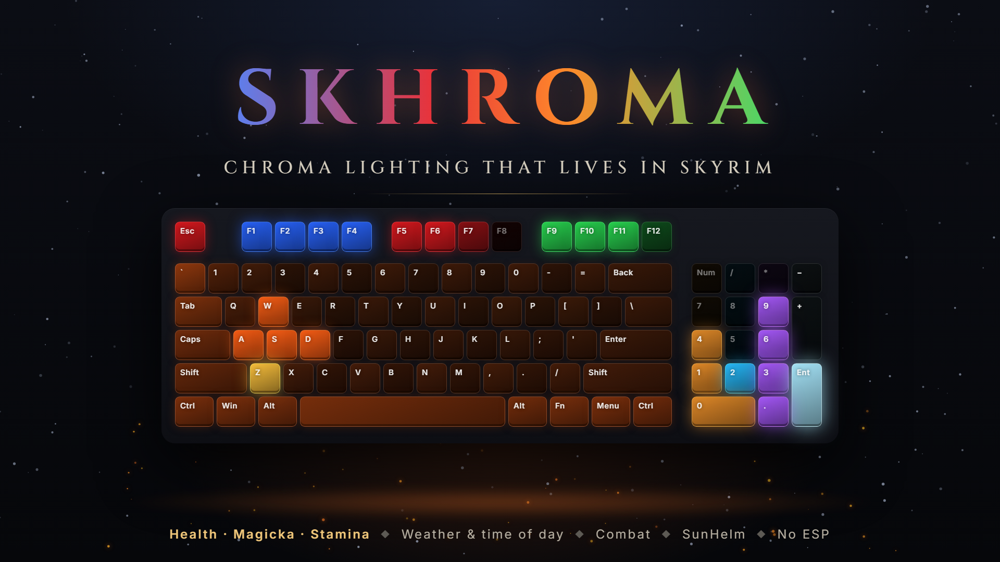

# Skhroma

**Download:** [Nexus Mods](https://www.nexusmods.com/skyrimspecialedition/mods/198505) · [GitHub Releases](https://github.com/nickolasdeluca/skhroma/releases)



Razer Chroma integration for Skyrim SE/AE as an SKSE plugin. Lights on every Chroma device react to the game: attributes, combat, damage, weather, time of day, transformations, menus and SunHelm survival needs (hunger, thirst, fatigue, cold).

Works with Razer Synapse or any compatible `RzChromaSDK64.dll` (e.g. open-chroma). Built with CommonLibSSE-NG via Address Library, so the DLL runs on 1.5.97 (Nolvus) and 1.6.x.

## What reacts

| Device | Layout |
|---|---|
| Keyboard | F1–F4 Magicka · F5–F8 Health · F9–F12 Stamina · WASD combat/low stamina · Z shout cooldown · Numpad SunHelm meters (hunger, thirst, fatigue, cold) · ESC alarm |
| Mouse | Left strip Health · right strip Stamina · rest ambient |
| Mousepad | Ring mirrors the HUD (Magicka / Health / Stamina) |
| Keypad | 4 SunHelm meters + Health column |
| Headset / Chroma Link | Ambient + all global effects |

Global layers on all devices: time-of-day and weather ambient (torchlight indoors, rain drops, snow flakes, lightning in storms), combat embers, sneak, swimming, werewolf / vampire lord / vampire, SunHelm frost creeping in from the edges, low-health heartbeat, hit/block flashes, level-up wave, dragon soul absorption, bleedout and death, menu dimming (map, lockpicking, sleep/wait have their own looks).

Everything can be toggled and tuned in `SKSE/Plugins/Skhroma.ini`.

Optional integrations switch on only when their plugin is loaded: SunHelm Survival (needs meters and frost), Dawnguard (Vampire Lord). Without them, those layers stay off.

## Requirements

- [SKSE64](https://skse.silverlock.org/)
- [Address Library for SKSE Plugins](https://www.nexusmods.com/skyrimspecialedition/mods/32444)
- Razer Synapse with Chroma enabled, or another `RzChromaSDK64.dll` provider such as open-chroma
- Optional: SunHelm Survival

## Installing

Install `Skhroma-<version>.zip` with Mod Organizer 2 or Vortex, or extract it into `Data/`. It contains only `SKSE/Plugins/Skhroma.dll`, `.ini` and `.pdb`. There is no `.esp`, so it does not use a plugin slot and can be added or removed mid-playthrough.

## Building

Requirements: Visual Studio 2022 (C++ workload or Build Tools), vcpkg with `VCPKG_ROOT` set.

```powershell
git clone --recurse-submodules https://github.com/CharmedBaryon/CommonLibSSE-NG.git external/CommonLibSSE-NG
cmake --preset vs2022
cmake --build --preset release
```

Output: `build/RelWithDebInfo/Skhroma.dll`. Install it together with `dist/SKSE/Plugins/Skhroma.ini` into `Data/SKSE/Plugins/`.

To build straight into an MO2 mod folder, create a `CMakeUserPresets.json` (git-ignored) that inherits `vs2022` and sets `SKHROMA_DEPLOY_DIR`.

`build/RelWithDebInfo/chroma_test.exe` is a smoke test of the Chroma layer that runs without the game.

`tools/package.ps1` packages the build into `out/Skhroma-<version>.zip` for release.

## Logs

`Documents/My Games/Skyrim Special Edition/SKSE/Skhroma.log`

## License

[MIT](LICENSE). Built on [CommonLibSSE-NG](https://github.com/CharmedBaryon/CommonLibSSE-NG) (MIT).
